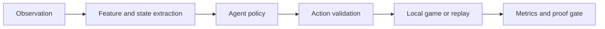

<div align="center">
  

  <p>
    
    
    
    <a href="LICENSE"></a>
  </p>
</div>

## 🌌 What it is

An agent-development and evaluation workspace for Kaggle Orbit Wars. It contains a game agent, deterministic simulation and geometry helpers, classical baselines, and an experimental JAX reinforcement-learning path. The repository emphasizes replay-based tests and explicit proof gates before any external submission.

## 🧠 Agent and evaluation path



## 🧪 What is here

- `main.py` is the competition entry point.
- `src/ow/` holds agent logic, game state, geometry, NumPy models, and RL components including a JAX environment/policy path.
- `baselines/` contains random, greedy, and style-bot examples.
- `tools/` includes replay parsing, local evaluations, model training, and a submission proof gate.
- `tests/` exercises agent behavior, game parity, RL components, replay handling, and evaluation gates.

The project includes both heuristic and RL experiments; model performance depends on the evaluation set and should not be inferred from architecture names alone.

## 🧰 Stack

| Area | Tools |
|---|---|
| Agent and simulation | Python, NumPy |
| RL experiment | JAX, optional Pygame viewer |
| Evaluation | pytest, local replay/ladder tools |
| Submission | `main.py`, build and proof-gate scripts |

## 🚀 Setup and test

```bash
git clone https://github.com/ChristopherJoshy/OrbitWars.git
cd orbit-wars
python -m venv .venv
# Windows: .venv\Scripts\Activate.ps1
# macOS/Linux: source .venv/bin/activate
pip install -r requirements.txt
pytest -q
```

Run `python main.py` only in the competition runner expected by the challenge. For local evaluation, inspect the available options first:

```bash
python tools/evaluate_ladder.py --help
python tools/proof_gate.py --help
```

A passing local gate does not submit anything. Follow the repo's explicit approval rule before uploading a submission.

## 🗂️ Layout

```text
src/ow/      agent, simulation, models and RL components
baselines/   reference policies
tests/       unit and parity tests
tools/       replay, evaluation, training and submission checks
```

## 📄 License

MIT. See [`LICENSE`](LICENSE).